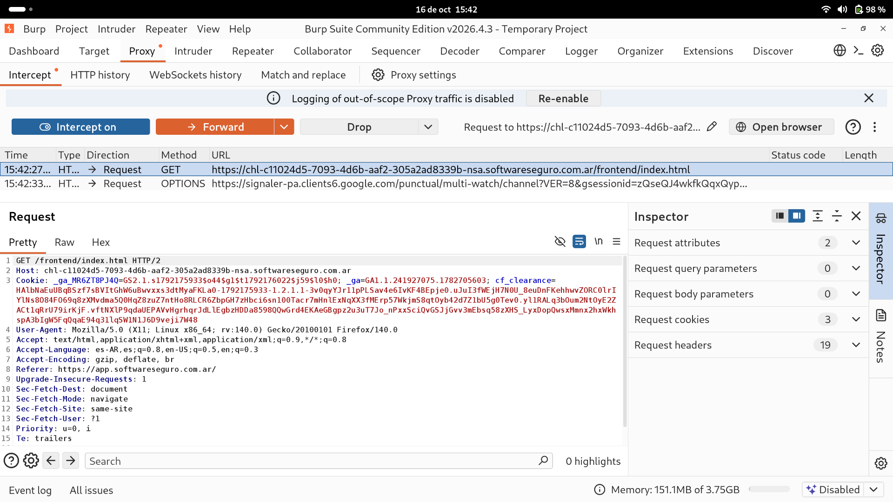
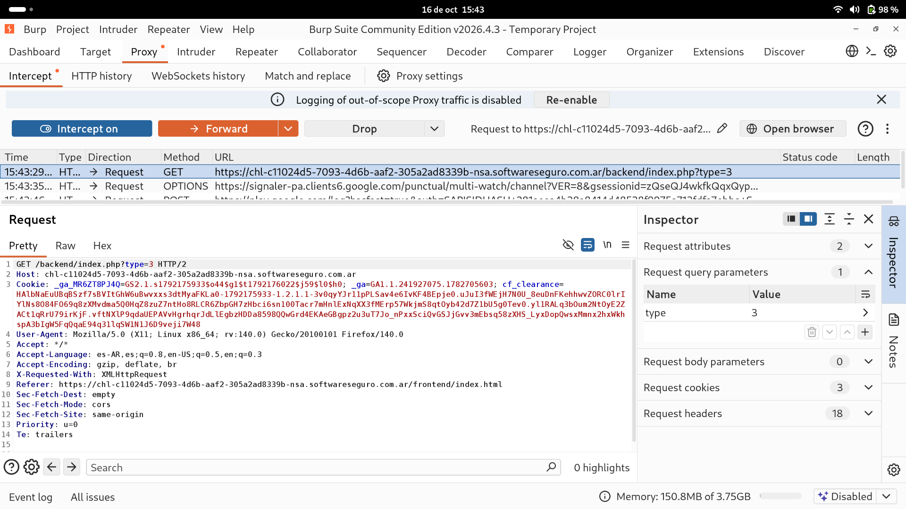

# Objetivo 1: Man-in-the-Middle Local (Configuración y Certificado CA)

En este laboratorio de la NSA, la misión consiste en ayudar a un agente a acceder a proyectos catalogados como "Top Secret" (tipo APT) que están ocultos por nivel de acceso en la aplicación. Para lograrlo, el primer paso fue configurarnos como intermediarios de la comunicación.

## Configuración del Entorno (Proxy y CA)
Para poder interceptar el tráfico, se realizaron dos configuraciones clave en el navegador Firefox:
1. **Enrutamiento:** Se configuró el navegador (Ajustes > Configuración de red > Proxy manual) para derivar todo el tráfico HTTP y HTTPS hacia el listener local de Burp Suite, escuchando en `127.0.0.1:8080`.
2. **Certificado CA:** Para poder leer e interceptar el tráfico cifrado (HTTPS) sin generar alertas de seguridad en el navegador, se descargó el certificado raíz de PortSwigger (navegando a `http://burp`) y se importó en el administrador de certificados de Firefox, otorgándole confianza para identificar sitios web.

## Intercepción y Análisis de Endpoints
Con el entorno listo y el botón "Intercept is on" activado en la pestaña Proxy de Burp Suite, se navegó por la aplicación capturando "en vuelo" las siguientes peticiones clave:

*   **Endpoint Frontend (`GET /frontend/index.html`)**
    *   **Descripción:** Es la petición inicial que realiza el navegador para solicitar la estructura visual y la interfaz de usuario de la aplicación.
    *   

*   **Endpoint Backend (`GET /backend/index.php?type=<valor>`)**
    *   **Descripción:** Es el endpoint principal del backend encargado de procesar los filtros de búsqueda. Utiliza el parámetro `type` en la URL (query string) para consultar la base de datos y traer los proyectos solicitados.
    *   

Al dejar pasar esta última petición (`Forward`), notamos que si el usuario realiza una búsqueda normal sin altos privilegios, el servidor responde pero oculta los proyectos confidenciales. Esta petición será la base para nuestro ataque en el siguiente objetivo.