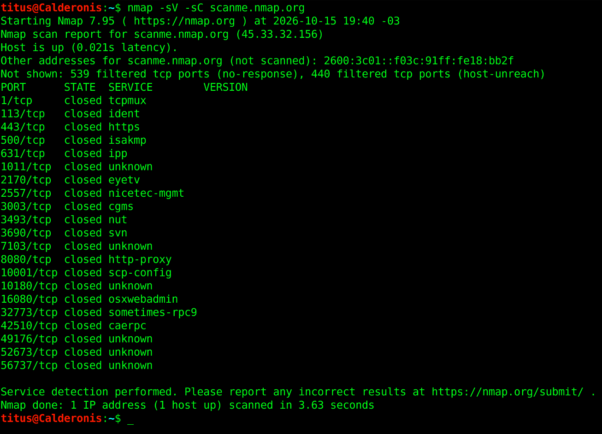

# Objetivo 2: Escaneo de Red (Nmap)

Para este laboratorio, se seleccionó el objetivo autorizado `scanme.nmap.org`, un servidor provisto por Nmap Security Scanner con el propósito explícito de permitir pruebas de escaneo automatizadas y legales.

## Justificación de la Elección del Objetivo
Aunque la consigna sugería utilizar un programa de Bug Bounty en plataformas como Bugcrowd, tras analizar múltiples políticas (Rules of Engagement / Scope) de distintos programas, se determinó que la inmensa mayoría prohíbe de forma estricta el uso de herramientas de escaneo automatizado. 

Incluso si no mencionan a Nmap por su nombre, las políticas prohíben explícitamente las pruebas volumétricas, la falta de control en el límite de peticiones (rate limiting) y cualquier comportamiento que pueda degradar la disponibilidad del servicio. Ejecutar un escaneo activo en entornos de producción viola estas cláusulas. Por lo tanto, para garantizar el cumplimiento 100% legal, evitar generar ruido en los SOC de las empresas y no arriesgar la suspensión de la cuenta en la plataforma, se optó por utilizar `scanme.nmap.org`, el cual otorga un permiso abierto y explícito para este tipo de laboratorios.

## Comando Ejecutado
Se utilizó el siguiente comando en la terminal para descubrir puertos y detectar versiones de servicios:
`nmap -sV -sC scanme.nmap.org`

- **-sV**: Intenta determinar la versión exacta del servicio que está corriendo en el puerto abierto.
- **-sC**: Ejecuta los scripts básicos por defecto de Nmap para obtener información adicional sobre el servicio detectado.

## Resultados del Escaneo

## Análisis de Puertos y Servicios Detectados
En este escaneo particular sobre los 1000 puertos por defecto de Nmap, no se encontraron puertos en estado `open` (abiertos). La infraestructura del objetivo devolvió la siguiente distribución:

- **Puertos Filtrados (979 en total):** El escaneo reporta 539 puertos ignorados (`no-response`) y 440 inalcanzables (`host-unreach`). Esto indica la presencia de un firewall o regla de enrutamiento bloqueando activamente las sondas enviadas desde mi dirección IP.
- **Puertos Cerrados (21 en total):** Se detectaron puertos en estado `closed`, lo que significa que son accesibles (no están bloqueados por un firewall), pero actualmente no hay ningún servicio o aplicación escuchando en ellos. Algunos ejemplos detectados en la prueba son:
  - **Puerto 443/tcp:** - Estado: closed - Servicio asignado: https
  - **Puerto 8080/tcp:** - Estado: closed - Servicio asignado: http-proxy
  - **Puerto 2170/tcp:** - Estado: closed - Servicio asignado: eyetv
