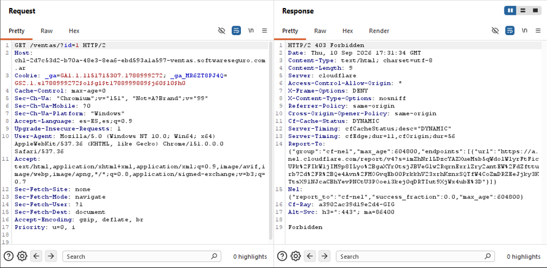

# Objetivo 4: Instalación y Configuración de Proxy  
## ¿Qué es un proxy?

Un proxy actúa como un intermediario absoluto entre mi navegador web (el cliente) y el servidor de destino. Al configurar Burp Suite, obligo a mi navegador a enviarle todo el tráfico HTTP y HTTPS primero a esta herramienta en lugar de mandarlo directamente a Internet.

### ¿Que diferencia tiene un *PROXY* con una VPN ?

Aunque ambos actúan como intermediarios en una red, su propósito y alcance técnico son completamente distintos en el ámbito de la ciberseguridad.  

Una VPN es un servicio que crea un túnel cifrado entre mi dispositivo y un servidor remoto, protegiendo todo el tráfico del sistema operativo (navegador, apps, mensajería, etc.).
  
A diferencia de una VPN, que cifra todo el tráfico de red, un proxy generalmente solo gestiona solicitudes específicas (como navegación web HTTP/HTTPS) y no siempre encripta los datos, aunque sí enruta el tráfico a través de una dirección IP distinta.

### Cuadro comparativo: 

| Característica | Proxy | VPN |
|---|---|---|
| **Cifrado** | No | Sí (extremo a extremo) |
| **Cobertura** | Una app o navegador | Todo el dispositivo |
| **Velocidad** | Generalmente más rápida (usa caché) | Ligeramente más lenta por el cifrado |
| **Privacidad** | Oculta la IP, pero los datos viajan en texto plano | Oculta la IP y cifra el contenido |
| **Protección frente a terceros** | No | Sí (hackers, ISP, WiFi pública) |
| **Costo** | Suelen ser gratuitos | Generalmente de pago |
| **Riesgo de venta de datos** | Sí (especialmente los gratuitos) | No (política de no-logs en las de pago) |
| **Estabilidad** | Baja (especialmente los gratuitos) | Alta |
| **Kill switch** | No | Sí |

### En resumen: 
una **VPN** es una solución más completa y segura, mientras que un **proxy** es una herramienta más ligera y rápida para tareas puntuales, pero sin protección real de los datos.

