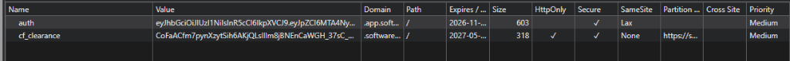
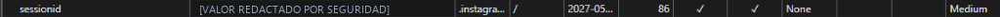
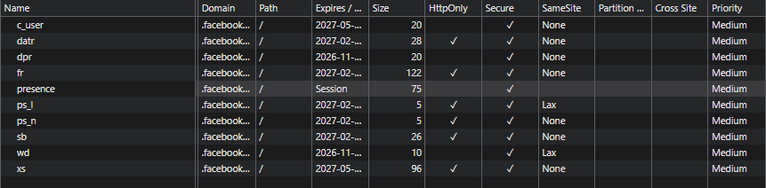

# Objetivo 1: Auditoría de Cookies y Banderas de Seguridad

En esta actividad se realizó un análisis pasivo de las cookies de sesión de **tres sitios web de uso público** (`app.softwareseguro.com.ar`, `instagram.com` y `facebook.com`) utilizando el Inspector del navegador (*DevTools → Application → Cookies*) para verificar la correcta implementación de las banderas de seguridad (`HttpOnly`, `Secure` y `SameSite`).

*(Por buenas prácticas de seguridad operativa, los valores sensibles de las cookies de sesión fueron redactados/recortados en las evidencias).*

---

## 1. Relevamiento comparativo de los 3 sitios analizados

| Sitio Web | Cookie de Sesión Principal | `HttpOnly` | `Secure` | `SameSite` | Alcance (`Domain` / `Path`) | Evaluación General |
| :--- | :--- | :---: | :---: | :---: | :--- | :--- |
| **`app.softwareseguro.com.ar`** | `auth` *(JWT de sesión)* | ❌ **No** | ✅ Sí | ✅ `Lax` | `.app.softwareseguro.com.ar` / `/` | **Mejorable:** Falta la bandera `HttpOnly` (`CWE-1004`). |
| **`instagram.com`** | `sessionid` | ✅ Sí | ✅ Sí | ⚠️ `None` | `.instagram.com` / `/` | **Correcta con salvedad:** Protegida contra XSS y MitM; al usar `SameSite=None`, depende de tokens anti-CSRF explícitos. |
| **`facebook.com`** | `xs` *(junto con `c_user`)* | ✅ Sí (`xs`) / ❌ No (`c_user`) | ✅ Sí | ⚠️ `None` | `.facebook.com` / `/` | **Correcta con salvedad:** El secreto de sesión (`xs`) tiene `HttpOnly` y `Secure`; compensa `SameSite=None` con tokens anti-CSRF (`fb_dtsg`). |

---

## 2. Análisis individual por sitio

### Sitio 1: `app.softwareseguro.com.ar` (Plataforma del curso)



* **`auth` (Cookie de autenticación JWT — 603 bytes):**
  * **`Secure` (✅ Activada):** Garantiza que el JWT solo viaje por HTTPS.
  * **`SameSite=Lax` (✅ Activada):** Mitiga ataques CSRF clásicos mediante formularios `POST` *cross-site*.
  * **`HttpOnly` (❌ Desactivada — Hallazgo principal):** Al omitirse esta bandera (**CWE-1004**), el JWT completo queda legible desde JavaScript (`document.cookie`), lo que permitiría robar la sesión ante una eventual vulnerabilidad de XSS.
* **`cf_clearance` (Cloudflare — 318 bytes):** Tiene `HttpOnly` ✅, `Secure` ✅ y `SameSite=None` con *Partition Key*.

### Sitio 2: `instagram.com`



* **`sessionid` (Cookie de sesión autenticada — 86 bytes):**
  * **`HttpOnly` (✅ Activada):** Impide que scripts del cliente accedan al identificador de sesión mediante `document.cookie`, protegiendo la cuenta frente a robo de sesión por XSS.
  * **`Secure` (✅ Activada):** Obliga al navegador a enviarla exclusivamente sobre HTTPS.
  * **`SameSite=None` (⚠️ Requiere defensa adicional):** Meta configura `SameSite=None` (permitido únicamente porque `Secure` está activo) para soportar integraciones *cross-site* (embeds y flujos federados). Por ello, la plataforma compensa la protección CSRF en el backend mediante tokens anti-CSRF dedicados (`csrftoken` / cabecera `X-CSRFToken`) y validación de origen.

### Sitio 3: `facebook.com`



* **`xs` (Cookie secreta de sesión — 96 bytes):** Es el token crítico que valida la sesión junto con el identificador de usuario. Implementa **`HttpOnly` ✅** y **`Secure` ✅**, con **`SameSite=None`** (al igual que Instagram, compensado del lado del servidor mediante tokens anti-CSRF como `fb_dtsg` y comprobación de `Origin`).
* **Cookies auxiliares de seguridad (`datr`, `sb`, `fr`, `ps_l`, `ps_n`):** Implementan consistentemente `HttpOnly` ✅ y `Secure` ✅ (con `SameSite=Lax` en `ps_l` y `None` en las de contexto *cross-site*).
* **Cookies no secretas leídas por el frontend (`c_user`, `dpr`, `wd`, `presence`):** Tienen `Secure` ✅, pero omiten `HttpOnly` de manera intencional porque el JavaScript de la aplicación necesita leer metadatos no secretos (como el ID público del usuario en `c_user`, resolución de pantalla en `wd`/`dpr` o estado de chat en `presence`), sin que ninguna de ellas permita autenticar la sesión por sí sola sin la cookie `xs`.

---

## 3. ¿Qué protege exactamente la bandera `HttpOnly`?

La bandera **`HttpOnly`** instruye al navegador para que la cookie **solo sea transmitida en peticiones HTTP/HTTPS al servidor**, bloqueando completamente su lectura o modificación desde JavaScript (`document.cookie`).

* **Qué mitiga:** Limita drásticamente el impacto de un ataque de **Cross-Site Scripting (XSS)**. Si el sitio llegara a tener una inyección de JavaScript y la cookie de sesión posee `HttpOnly` (como en `instagram.com` con `sessionid` y `facebook.com` con `xs`), el script malicioso **no puede extraer el token de sesión** para enviarlo al atacante y clonar la sesión (*Session Hijacking*).
* **Impacto cuando falta (`app.softwareseguro.com.ar`):** La ausencia de `HttpOnly` en la cookie `auth` (**CWE-1004: Sensitive Cookie Without 'HttpOnly' Flag**) deja el JWT expuesto a lectura directa desde cualquier script que logre ejecutarse en el dominio.

---

## 4. ¿Qué riesgo corre el usuario si la cookie de sesión no tiene la bandera `Secure`?

La bandera **`Secure`** restringe al navegador a enviar la cookie **exclusivamente a través de conexiones cifradas (HTTPS / TLS)**.

Si una cookie de sesión **no tiene `Secure` activada** (**CWE-614: Sensitive Cookie in HTTPS Session Without 'Secure' Attribute**):
1. **Transmisión en texto plano (MitM):** Si el usuario se conecta desde una red no confiable (como un Wi-Fi público) y el navegador realiza una sola solicitud en claro por `http://` hacia el dominio —por ejemplo, al tipear la URL sin `https://`, abrir un enlace antiguo o sufrir un ataque de degradación (*SSL Stripping*)—, el navegador adjuntará automáticamente la cookie de sesión **sin cifrar**.
2. **Secuestro inmediato de sesión (*Session Hijacking*):** Un atacante en la misma red que capture ese tráfico HTTP obtiene el token de sesión en texto plano y puede inyectarlo en su navegador para acceder a la cuenta de la víctima sin conocer su contraseña ni su segundo factor (MFA).

---

## 5. Conclusión y recomendación

Los tres sitios evaluados protegen correctamente sus cookies en tránsito mediante **`Secure`**. Sin embargo, mientras que **`instagram.com`** y **`facebook.com`** resguardan sus tokens secretos de sesión (`sessionid` y `xs`) con **`HttpOnly`**, la cookie `auth` de **`app.softwareseguro.com.ar`** carece de esa bandera. La configuración recomendada bajo **OWASP ASVS (V3.4)** para cookies de sesión es:

```http
Set-Cookie: auth=<JWT>; Path=/; HttpOnly; Secure; SameSite=Lax
```
