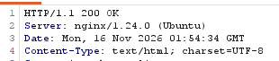

# [PLANTILLA DE REPORTE DE VULNERABILIDAD]

**ID del Reporte:** #VULN-2026-001
**Título:** Exposición de Versión del Servidor y Sistema Operativo en Cabeceras HTTP (Security Misconfiguration)
**Fecha de Detección:** 15/11/2026
**Autor:** Elio Caseres
**Criticidad:** Media

## 1. Resumen Ejecutivo

**Descripción General:**
Se ha identificado una vulnerabilidad de Configuración Insegura (Security Misconfiguration) en el servidor web principal de la institución. Este fallo permite a un atacante, mediante un simple reconocimiento pasivo, conocer exactamente el software utilizado en el backend y su versión específica, junto con detalles del sistema operativo subyacente (`nginx/1.24.0 (Ubuntu)`).

**Impacto en el Negocio:**
La explotación de esta vulnerabilidad podría resultar en una aceleración drástica de la fase de reconocimiento para un atacante potencial. Al conocer la versión exacta del servicio, un ciberdelincuente puede buscar vulnerabilidades públicas conocidas (CVEs) y exploits diseñados específicamente para esa versión, aumentando el riesgo de un ataque dirigido y exitoso. La complejidad para llevar a cabo este reconocimiento es Baja, lo que representa un riesgo innecesario para la organización.

## 2. Detalles Técnicos

* **Activo Afectado:** `https://www.frc.utn.edu.ar`

* **Endpoint / Parámetro:** Afecta globalmente a las respuestas HTTP del servidor (Ej: `GET /`). El parámetro afectado es la cabecera HTTP de respuesta `Server`.

* **Tipo de Vulnerabilidad:** CWE-200: Exposure of Sensitive Information to an Unauthorized Actor / Security Misconfiguration.

* **Precondiciones:** No se requiere autenticación ni interacción especial. El atacante solo necesita enviar una petición HTTP válida al servidor.

## 3. Métricas CVSS (Common Vulnerability Scoring System)

* **Puntuación Base (Score):** 5.3 (Media)

* **Vector CVSS:** CVSS:3.1/AV:N/AC:L/PR:N/UI:N/S:U/C:L/I:N/A:N

* *Desglose:*

  * **Vector de Ataque (AV):** Red (Network)

  * **Complejidad del Ataque (AC):** Baja (Low)

  * **Privilegios Requeridos (PR):** Ninguno (None)

  * **Interacción del Usuario (UI):** Ninguna (None)

  * **Confidencialidad (C):** Baja (Low) - Expone metadatos del entorno, no datos de usuarios.

  * **Integridad (I):** Ninguna (None)

  * **Disponibilidad (A):** Ninguna (None)

## 4. Prueba de Concepto (PoC)

A continuación, se detallan los pasos exactos para reproducir la vulnerabilidad de manera totalmente pasiva.

**Herramientas utilizadas:** Navegador Web, Proxy HTTP (Burp Suite Professional / Community).

**Pasos para reproducir:**

1. Configurar el navegador para enrutar el tráfico a través del proxy HTTP local.
2. Navegar a la URL objetivo: `https://www.frc.utn.edu.ar/`.
3. Interceptar o visualizar el historial de tráfico y localizar la petición `GET / HTTP/1.1`.
4. Inspeccionar las cabeceras de la respuesta (Response Headers) enviadas por el servidor.

**Resultado Observado:**
El servidor procesa la petición y devuelve un `HTTP 200 OK`, exponiendo en sus cabeceras la directiva `Server` con el valor exacto del software y el sistema operativo.

**Evidencia adjunta:**

## 5. Recomendaciones de Remediación

Para solucionar esta vulnerabilidad, se recomienda implementar las siguientes medidas:

**Remediación a Corto Plazo (Inmediata):**

* Ocultar la versión expuesta modificando la configuración del servidor Nginx. Para ello, editar el archivo principal (`/etc/nginx/nginx.conf`), agregar o descomentar la directiva `server_tokens off;` dentro del bloque `http {}` y reiniciar el servicio (`sudo systemctl restart nginx`).

**Remediación a Largo Plazo (Definitiva):**

* Implementar y mantener un estándar de endurecimiento (Hardening) en todos los servidores web de producción, asegurando que ninguna cabecera revele información de la infraestructura (`X-Powered-By`, `Server`, etc.).
* Desplegar un Web Application Firewall (WAF) o un proxy inverso que filtre y estandarice las cabeceras HTTP de respuesta antes de que lleguen al cliente final.

**Referencias para el equipo de desarrollo:**

* [OWASP: Information Leakage](https://owasp.org/www-community/vulnerabilities/Information_Leakage)
* [Nginx Core Module Documentation: server_tokens](https://nginx.org/en/docs/http/ngx_http_core_module.html#server_tokens)